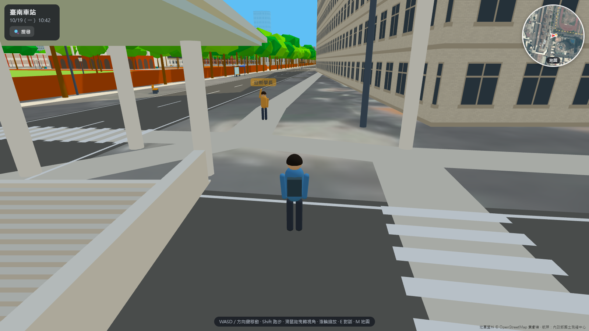
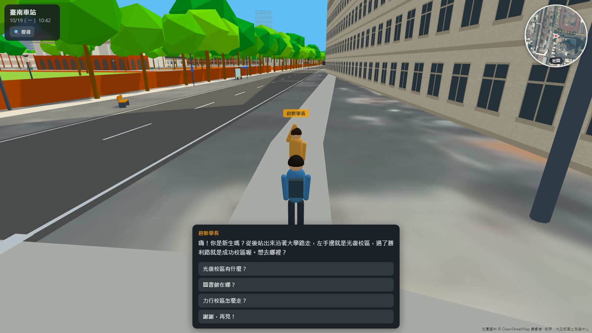
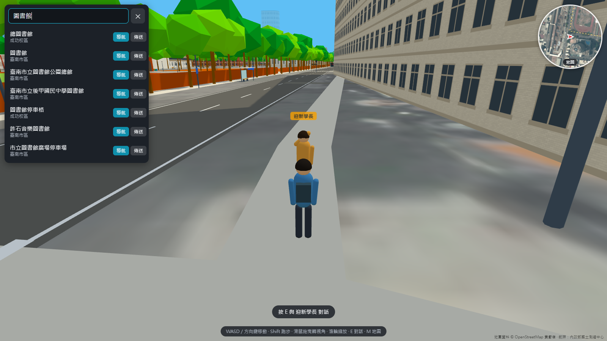
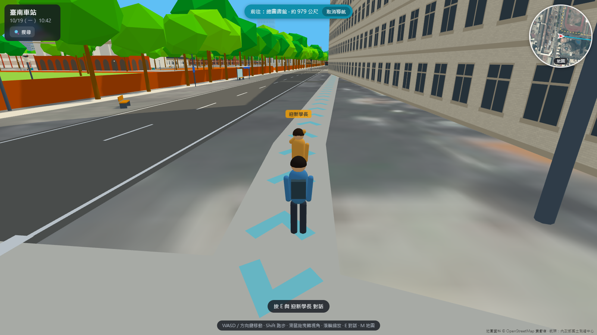
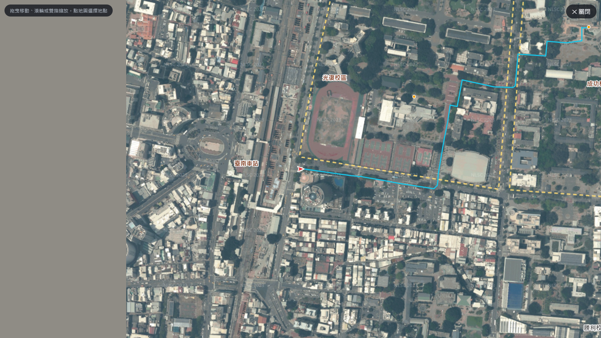
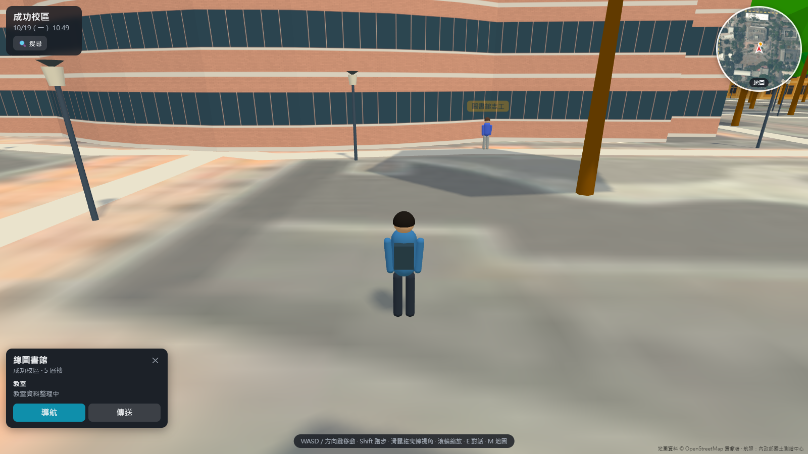
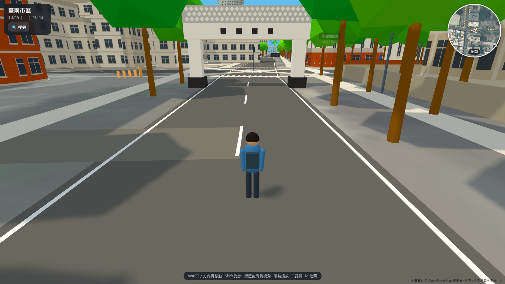
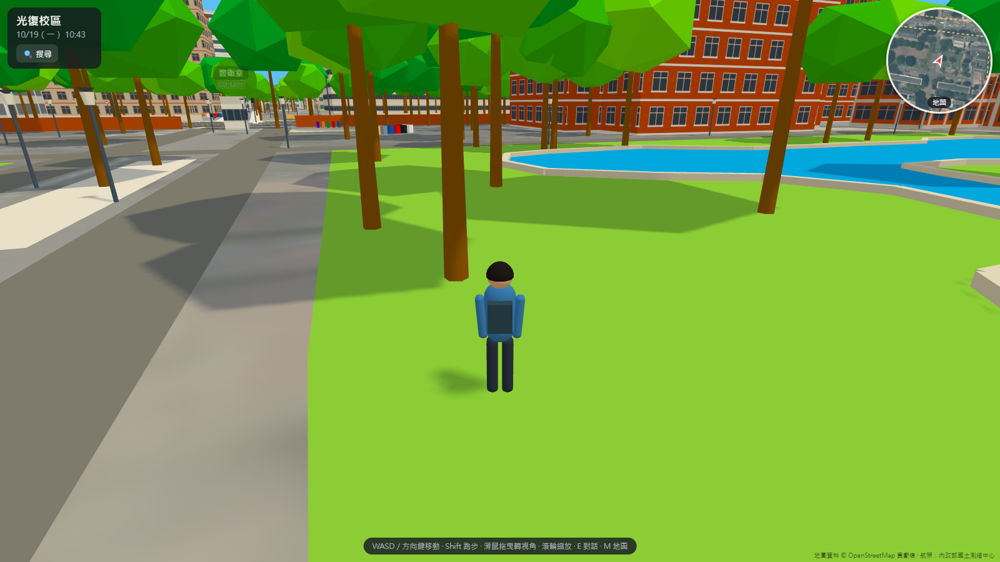

# 規格書：成大校園 3D 模擬器

> 線上試玩：https://yoyohuang1012.github.io/ncku-campus-3d/
> 原始碼：https://github.com/yoyohuang1012/ncku-campus-3d

## 1. 一句話介紹

在瀏覽器裡走一趟真實比例的成大：從剛通車的新臺南車站出站，沿大學路走進光復、成功、力行三個校區，可以自由探索、找 NPC 聊天、搜尋系館並跟著地上的箭頭導航。

## 2. 發想動機

- 新生、轉學生、來參訪的高中生常常分不清「哪一館在哪裡」。官方校園地圖是平面示意圖，看了還是不知道建築長什麼樣子。
- 臺南車站在 2026/10/17 地下化通車，出入口全部改變，連在校生都要重新認路。
- 所以我想做一個「打開網頁就能先走一遍」的 3D 校園。它不只是看地圖，而是像遊戲一樣用第三人稱走過去，看到的建築外觀、相對位置都要接近現場。

## 3. 目標使用者與情境

| 使用者 | 情境 | 需要的功能 |
|---|---|---|
| 新生／轉學生 | 開學前想先認路 | 從車站走到系館、搜尋系館、導航箭頭 |
| 在校生 | 找沒去過的教室或建築 | 搜尋、地圖點選傳送 |
| 參訪者、家長 | 想看看校園長什麼樣子 | 自由探索、建築資訊、NPC 介紹 |
| 手機使用者 | 通勤時隨手打開 | 觸控搖桿、手機畫質自動降低 |

## 4. 功能規格

每項功能下面列出「驗收條件」，也就是做完後要能實際操作確認的事。

### F1 真實比例的 3D 校園場景

- 範圍：臺南車站（舊站房、新地下車站 3 個出入口、下沉廣場、大頂棚）→ 大學路 → 光復校區 → 成功校區 → 力行校區，可以一路走過去不中斷。
- 建築位置與輪廓來自 OpenStreetMap，地面鋪上內政部國土測繪中心的正射航照。
- 主要建築（94 棟）逐棟調整外觀：牆色、窗型、屋頂形式、柱廊、挑出量體。
- 環境細節：
  - 圍牆、行道樹、椰林大道、路燈、座椅、垃圾桶、公車亭、雕塑；
  - 地標：成功湖、勝利路天橋、大學路牌坊、光復大門、小東門城垣殘蹟；
  - 地面：道路標線（雙黃線、白虛線、斑馬線）、操場與球場。
- 範圍外的市區用簡化方塊與霧帶過。
- **驗收**：從車站出口走到力行校區，沿路建築的相對位置與官方地圖、航照一致；主要建築看得出是哪一棟。

### F2 第三人稱角色移動

- 電腦：WASD／方向鍵移動、Shift 跑步、滑鼠拖曳轉視角、滾輪縮放。
- 手機：左下角虛擬搖桿移動，右半邊拖曳轉視角。
- 有碰撞：會被建築、圍牆擋住；可以走上棧橋、走下下沉廣場的階梯。
- 攝影機遇到牆會自動拉近，不會穿牆。
- **驗收**：按鍵後角色會移動並播放走路動畫；撞牆會停下；可以走下下沉廣場再走上來。

### F3 搜尋與導航

- 左上角資訊框裡的「🔍 搜尋」可以輸入建築名稱、系館、別名（例如「圖書館」「活中」「後站」）。
- 搜尋結果可選「導航」或「傳送」：
  - **導航**：地面出現路線箭頭，畫面上方顯示目的地與剩餘距離，抵達後提示「已抵達」；
  - **傳送**：直接移動到該建築前。
- **驗收**：搜尋任一系館後按導航，地上出現路線；沿著走能走到目的地。

### F4 小地圖與大地圖

- 右上角圓形小地圖會跟著玩家轉動，按 M 或點擊可以展開成全螢幕大地圖。
- 大地圖可以拖曳、縮放，點任一位置可以選「傳送到這裡」或「導航到這裡」。
- **驗收**：在大地圖點光復校區任一點並選傳送，角色立刻出現在該處。

### F5 建築資訊

- 點擊建築會在左下角跳出資訊卡，內容是名稱、樓層數、所屬校區、教室清單，也可以從資訊卡直接導航或傳送。
- 教室資料尚在整理中，目前顯示「教室資料整理中」。
- **驗收**：點任一已命名建築會出現正確名稱與樓層。

### F6 NPC 與對話

- NPC 依「星期幾、幾點」的排程出現在不同地點。例如：
  - 迎新學長整天在車站 2 號出口；
  - 平日晚上熱舞社社員在第一活動中心練舞。
- 靠近 NPC 時出現「按 E 對話」，對話是樹狀選項。選項可以觸發動作，例如「帶我過去」會直接開始導航。
- **驗收**：在車站出口找到迎新學長，按 E 後可以選擇問題，選「帶我過去」會開始導航。

### F7 時間與地點顯示

- 左上角顯示目前所在的區域（臺南車站／光復校區…）、日期與時間（跟著真實時間走）。
- 天空與光線依照設定呈現。
- **驗收**：走進不同校區時，左上角的區域名稱會跟著改變。

## 5. 非功能需求

| 項目 | 規格 |
|---|---|
| 平台 | 桌機與手機瀏覽器（Chrome／Edge／Safari），不需安裝 |
| 效能 | 建築依區塊合併繪製；手機自動降低解析度與陰影；樹木、路燈用 InstancedMesh |
| 風格 | 「風格化寫實」：形狀簡化，但比例、顏色、材質接近現場；整體色調偏明亮（多巴胺配色） |
| 資料驅動 | 建築、NPC、對話、介面文字、顏色全部寫在 JSON，不改程式就能修改內容 |
| 多語系 | 所有介面文字集中在 `i18n/zh-TW.json`，之後可加英文 |
| 授權 | 只用開放資料（OSM、國土測繪中心航照）；網路照片、影片只當參考，**不嵌入作品** |

## 6. 畫面配置

畫面中央是 3D 場景與角色（第三人稱，攝影機在角色背後），介面元素分在四個角落，不擋住前方視野：

| 位置 | 元素 |
|---|---|
| 左上 | 資訊框：目前區域、日期時間、🔍 搜尋按鈕；搜尋時展開成搜尋面板 |
| 上方中間 | 導航中顯示「前往：○○ · 約 N 公尺」與「取消導航」 |
| 右上 | 圓形小地圖（航照底圖、玩家箭頭、導航路線），點開是全螢幕大地圖 |
| 左下 | 點建築後的資訊卡（名稱、校區、樓層、教室、導航／傳送）；手機版的虛擬搖桿 |
| 下方中間 | NPC 對話框與選項；平常顯示操作說明 |
| 右下 | 資料來源標示（OpenStreetMap、國土測繪中心） |

實際畫面見第 9 節截圖。

## 7. 技術架構

- **語言與套件**：TypeScript、three.js（3D 繪圖）、three-mesh-bvh（碰撞）、straight-skeleton（自動算四坡屋頂）。
- **開發工具**：Vite。
- **交付形式**：`npm run build:pages` 用 `vite-plugin-singlefile` 把所有 CSS 與 JavaScript 內嵌進**單一 `docs/index.html`**。地圖資料（JSON、航照圖磚）放在 `docs/data/`，用相對路徑讀取，再由 GitHub Pages 從 `docs/` 公開。
- **程式結構**：

| 資料夾 | 內容 |
|---|---|
| `src/core` | 資料載入、時鐘、輸入、多語系、色調 |
| `src/world` | 建築、立面、屋頂、道路標線、地標、街道家具、碰撞 |
| `src/player` | 角色、移動、第三人稱攝影機 |
| `src/nav` | 路網與 A* 導航 |
| `src/npc` | NPC 排程與動畫 |
| `src/ui` | 搜尋、地圖、對話框、建築資訊、HUD |
| `public/data` | 所有內容資料（JSON） |
| `tools/osm` | 把 OpenStreetMap 原始資料轉成遊戲用的 `generated.json` |

- **規模**：程式約 5,100 行。場景有 1,039 棟建築、2,063 條道路、2,762 棵樹、442 個街道設施。另有 55 種建築外觀風格，其中 94 棟主要建築逐棟調整。

## 8. 和 AI 反覆調整的開發歷程

整個作品是我用 Vibe Coding 的方式和 AI（Claude Code）一起做的：我負責講想法、看畫面、挑錯，AI 負責寫程式、找參考資料、截圖給我比對。以下是主要的幾輪修改：

| 輪次 | 我提出的想法或問題 | AI 的處理 | 結果 |
|---|---|---|---|
| 1 | 想做可以走的 3D 成大，要能找 NPC 聊天、搜尋導航 | 一起討論出規格：範圍、平台、風格、資料驅動架構 | 定案規格（本文件） |
| 2 | 先做出可以走的版本 | 用 OSM 資料自動產生灰盒子校園＋角色移動＋碰撞 | 三個校區都能走 |
| 3 | 「完全不像」 | 疊上國土測繪中心航照比對，發現 OSM 缺很多校外建築，逐一描補；起點移到新車站出口 | 位置關係正確 |
| 4 | 建築外觀要像 | 建立建築風格系統（牆色、窗型、屋頂），依成大素材網官方照片逐棟調整 | 光復、成功、力行大多數建築有自己的外觀 |
| 5 | 要和 Google 街景一棟一棟比 | 新增「從街景同一位置、同一角度渲染」的功能，做成校對頁逐棟對照修正 | 光復 24 棟、成功 29 棟完成對照 |
| 6 | 顏色太暗，想要「多巴胺」的明亮感 | 加全域色調、航照地面調色、天空光線設定 | 整體變明亮 |
| 7 | 補勝利路天橋、校門、成功湖、城垣、公車亭、椰林大道 | 新增地標系統（天橋、水面、小橋、椰子樹、候車亭） | 地標完成 |
| 8 | 「第一活動中心長這樣（附學務處網址）」、地上要畫馬路和球場 | 依照片改成白柱廊＋逐層挑出的褐色量體；新增道路標線與操場球場 | 相對位置一目了然 |
| 9 | 新臺南車站剛通車，要做出入口 | 搜尋新聞與官方照片，做出下沉廣場（真的走得下去）、大頂棚、棧橋、出入口站體 | 3 個出入口完成 |
| 10 | 「這支開箱影片請一一對照比對」 | 從影片逐段擷取畫面對照，修正階梯方向、門的位置、螢幕、石牆、牆面圓形裝飾 | 車站與影片一致 |
| 11 | 要交作業 | 打包成單一 `index.html`、寫規格書、上傳 GitHub Pages | 本次繳交版本 |
| 12 | 上線後實測 | AI 用瀏覽器自動操作線上網站並截圖，發現「點總圖書館卻顯示門診大樓」的 bug。原因是碰撞加速結構（BVH）會重排三角形順序；改用 indirect 模式後修好，並用 200 棟建築自動驗證 | 點選建築資訊正確 |

每一輪 AI 都會截圖給我看。我再指出哪裡不像，例如「這棟屋頂顏色不對」「樓梯方向反了」，AI 修改後重新截圖，直到我覺得可以為止。

## 9. 介面截圖

| | |
|---|---|
|  起點：新臺南車站 2 號出口 |  F6 與迎新學長對話 |
|  F3 搜尋「圖書館」 |  F3 地面導航箭頭與剩餘距離 |
|  F4 大地圖與導航路線 |  F5 點總圖書館看資訊 |
|  F1 大學路牌坊 |  F1 成功湖 |

## 10. 規格與實作對照

| 規格 | 狀態 | 備註 |
|---|---|---|
| F1 3D 場景（車站＋三校區） | ✅ 完成 | 94 棟主要建築逐棟調整外觀 |
| F2 角色移動（鍵盤、滑鼠、觸控） | ✅ 完成 | 含碰撞、走得下去的下沉廣場 |
| F3 搜尋與導航 | ✅ 完成 | A* 路網，地面箭頭 |
| F4 小地圖／大地圖／傳送 | ✅ 完成 | |
| F5 建築資訊 | 🟡 部分 | 名稱、樓層已有；教室清單整理中 |
| F6 NPC 對話 | ✅ 完成 | 4 位測試 NPC，依時間排程出現 |
| F7 時間與地點顯示 | ✅ 完成 | |
| 單一 index.html＋GitHub Pages | ✅ 完成 | CSS／JS 全部內嵌 |

## 11. 未來規劃

1. 從成大課程系統整理各館教室與樓層，讓搜尋可以直接找教室。
2. 更多 NPC（每天輪換）與校園小遊戲。
3. 路上的行人、腳踏車、機車與車流。
4. 新臺南車站 B1／B2 地下大廳，以及主要建築室內可以走進去。
5. 英文介面。

## 12. 資料來源與授權

- 地圖資料 © OpenStreetMap 貢獻者（ODbL）。
- 正射航照：內政部國土測繪中心（政府資料開放授權）。
- 外觀參考資料只用來對照，作品中沒有嵌入任何網路照片或影片：
  - 成大素材網官方照片；
  - Google 街景（只觀看）；
  - 鐵道局與新聞照片；
  - YouTube 開箱影片〈新台南車站通車了！首日開箱〉（Taiwan Wanderer）。
